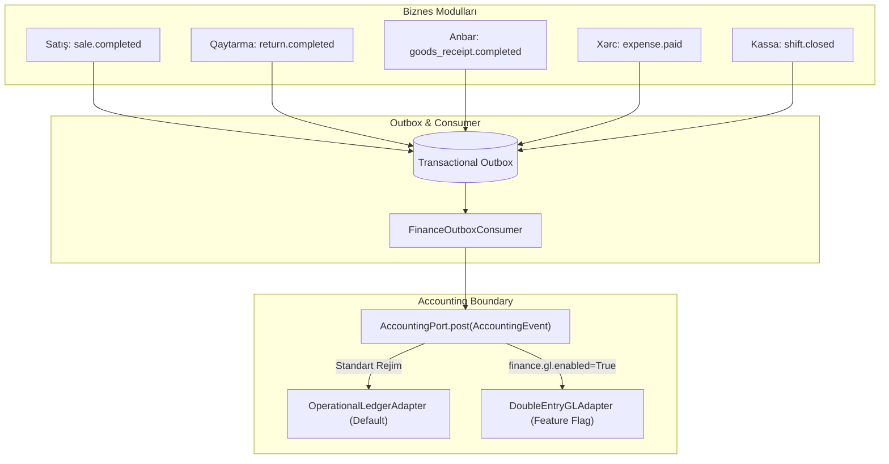
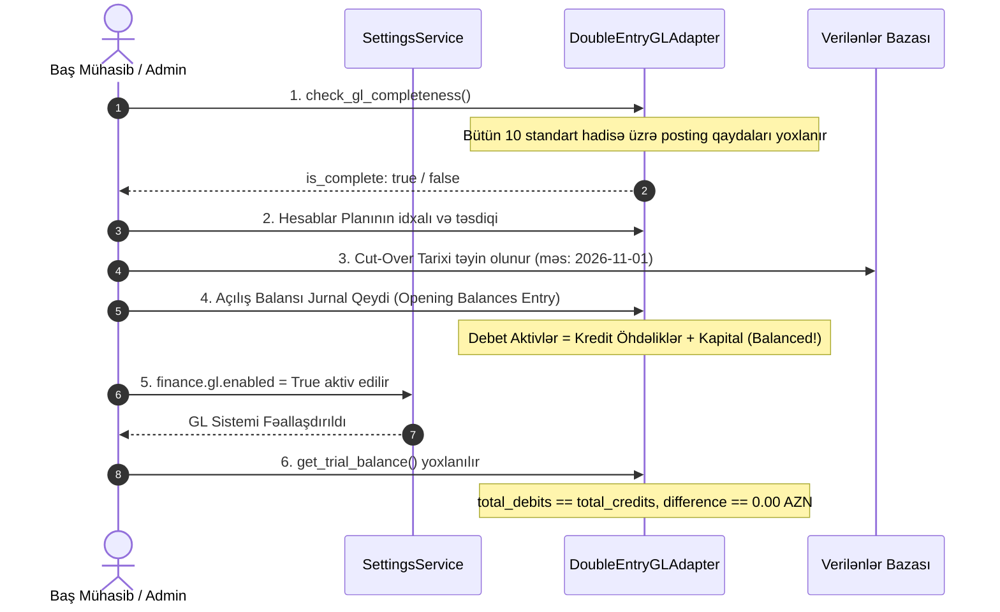

# Mühasibat İnteqrasiya Sərhədi və Baş Kitab Memarlığı (Accounting Integration Boundary & GL)

## 1. Memarlıq Sərhədi və Port Modeli (Architectural Boundary)

Brend House backend sistemində operativ ticarət modulları (POS, Satış, Qaytarmalar, Anbar, Satınalma) ilə maliyyə-mühasibat sistemi arasında **Hexagonal Architecture (Ports and Adapters)** prinsipi tətbiq olunmuşdur.

Biznes modulları mühasibat uçotunun daxili detallarından (hesab nömrələri, ikitərəfli müxabirləşmələr, debet/kredit qaydaları) asılı deyildir. Onlar baş verən maliyyə hadisələrini standart **`AccountingPort`** interfeysinə yönləndirirlər:

---

## 2. Mühasibat Hadisələri Matrisi (Accounting Events Table)

| Hadisə Növü (`event_type`) | Hadisənin İqtisadi Mənası | Məbləğ Bölgüsü (`net`, `tax`, `cost`, `gross`) | İlkin Mənbə Sənəd |
|---|---|---|---|
| **`SALE_RECOGNIZED`** | Satışın tamamlanması və gəlirin tanınması | Gross: Çek cəmi, Net: Xalis gəlir, Tax: ƏDV | `sales` |
| **`RETURN_RECOGNIZED`** | Qaytarmaya görə mənfi gəlir və vergi bərpası | Mənfi dəyərlər (Negative Net & Tax) | `sale_returns` |
| **`COGS_RECOGNIZED`** | Satılmış məhsulun anbar maya dəyərinin silinməsi | Cost: $\sum(\text{sold\_qty} \times \text{cost\_price})$ | `sale_lines` |
| **`INVENTORY_RECEIVED`** | Təchizatçıdan anbara mal mədaxili | Cost: Faktiki qəbul dəyəri | `goods_receipts` |
| **`SUPPLIER_INVOICE_APPROVED`** | Təchizatçı qaiməsinin təsdiqi və borcun tanınması | Gross: Qaimə cəmi, Tax: Daxil olan ƏDV | `supplier_invoices` |
| **`SUPPLIER_PAYMENT`** | Təchizatçıya bank və ya kassa ödənişi | Gross: Ödənilən məbləğ | `supplier_payments` |
| **`EXPENSE_PAID`** | Əməliyyat xərcinin hesabdan çıxarılması | Gross: Xərc cəmi, Net: Xalis, Tax: Vergi | `expenses` |
| **`PAYROLL_POSTED`** | Əmək haqqı cədvəlinin yekunlaşdırılması | Gross: Xalis maaş və tutulmalar | `payroll_runs` |
| **`CASH_VARIANCE`** | Kassa növbəsi bağlanışında artıq/əskik | Gross: Artıq (+), Əskik (-) | `register_shifts` |
| **`BANK_FEE`** | Bank və POS terminal komissiyaları | Gross: Komissiya məbləği | `account_transfers`, `reconciliations` |
| **`ADJUSTMENT`** | İnzibatçı tərəfindən aparılan maliyyə düzəlişi | Gross: Düzəliş məbləği | `account_transactions` |

---

## 3. İki İcraçı Adapter (The Two Implementations)

### İcraat A: `OperationalLedgerAdapter` (Standart / Default)
- **Vəzifəsi:** Sistemdə ikitərəfli mühasibat (Double-Entry GL) aktiv olmadıqda belə, bütün maliyyə faktlarını operativ olaraq `operational_postings` cədvəlində saxlayır.
- **Üstünlüyü:** Mürəkkəb hesablar planı tələb etmir, yüksək məhsuldarlıqlıdır və P&L, Pul Vəsaitlərinin Hərəkəti (Cash Flow) hesabatlarını tam formalaşdırır.

### İcraat B: `DoubleEntryGLAdapter` (Opsional / Feature Flag)
- **Vəzifəsi:** `finance.gl.enabled = True` olduqda işə düşür.
- **Xüsusiyyətləri:**
  1. Hər bir əməliyyat üzrə `JournalEntry` və `JournalLine` cədvəllərinə balanslaşdırılmış yazı vurur.
  2. **Verilənlər bazası CheckConstraint:** `total_debit == total_credit` və `total_debit > 0`. Balans pozulduqda tranzaksiya bazada icazə verilmədən dayanır.
  3. **Posting Rules:** Hadisələrin debet və kredit hesablarına eşləşməsi `posting_rules` cədvəlində qüvvəyə minmə tarixi ilə tənzimlənir.
  4. Əgər parametr deaktivdirsə (`finance.gl.enabled = False`), bütün GL endpointləri dərhal **`400 NOT_ENABLED`** qaytarır (heç vaxt saxta jurnal simulyasiyası aparılmır).

---

## 4. Neytral Hesablar Planı Şablonu (Chart of Accounts Template)

Sistemlə birlikdə neytral beynəlxalq tədris şablonu təqdim olunur:
- Fayl yolu: [`app/modules/finance/chart_of_accounts_template.json`](file:///c:/Users/Elshan/Desktop/brend_house/backend/app/modules/finance/chart_of_accounts_template.json)
- Şablon strukturunda 6 kateqoriya mövcuddur: `asset` (aktivlər), `liability` (öhdəliklər), `equity` (kapital), `revenue` (gəlir), `expense` (xərc), `contra` (tənzimləyici kontra-hesablar).

---

## 5. Baş Kitabın Canlı Sistemə Qoşulması Proseduru (Mid-Life GL Cut-Over Procedure)

Əgər ticarət sistemi bir müddət `OperationalLedgerAdapter` ilə işlədikdən sonra ikitərəfli Baş Kitaba (GL) keçmək qərarı verilərsə, aşağıdakı ardıcıllıq mütləq icra olunmalıdır:

---

## 6. Açıq Suallar və Fərziyyələr (Assumptions & Open Questions)

1. **Azərbaycan MMUS Hesablar Planı:**
   Azərbaycan Respublikası Maliyyə Nazirliyinin təsdiq etdiyi Kommersiya Təşkilatları üçün Hesablar Planına (3 rəqəmli standart hesablar: 101, 102, 201, 531, 601 və s.) uyğunlaşdırma yerli baş mühasib tərəfindən həyata keçirilməlidir.
2. **Elektron Qaimə-Faktura (e-qaimə) İnteqrasiyası:**
   Dövlət Vergi Xidmətinin (DVX) portalı ilə avtomatlaşdırılmış e-qaimə mübadiləsi növbəti xarici inteqrasiya fazasına saxlanılmışdır.
3. **Valyuta Məzənnə Fərqləri:**
   Sistem çoxvalyutalı əməliyyatları dəstəkləyir, lakin Azərbaycan Mərkəzi Bankının (AMB) rəsmi məzənnəsi ilə avtomatik yenidən qiymətləndirmə (FX revaluation) gündəlik inteqrasiya xidməti tələb edir.

