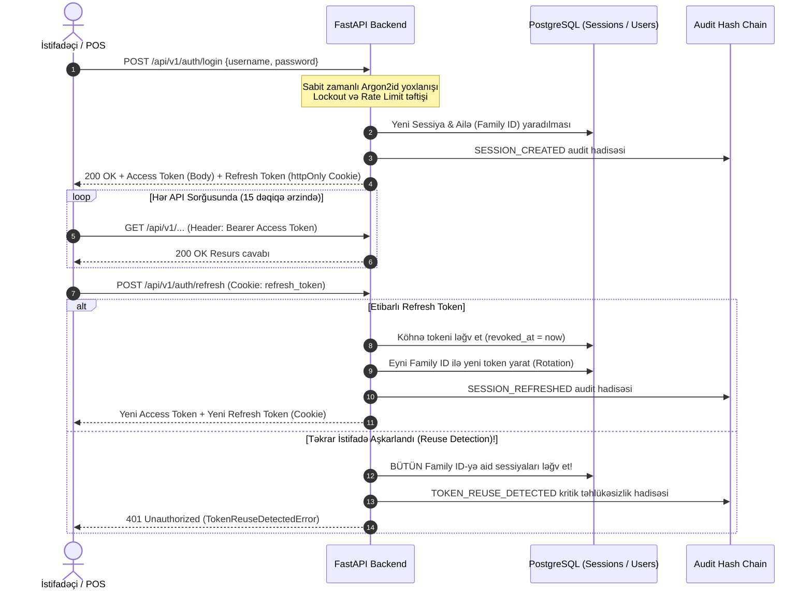

# Brand House ERP — Autentifikasiya və Sessiya Arxitekturası (docs/auth.md)

Bu sənəd Brand House ERP sisteminin `auth` və `sessions` modullarının təhlükəsizlik arxitekturasını, kriptoqrafik prinsiplərini və API iş axınlarını ətraflı izah edir.

---

## 1. Sessiya və Token Həyat Dövrü (Session & Token Lifecycle)

Brand House ERP hibrid token modeli (Dual-Token Pattern) tətbiq edir:
1. **Access Token (Qısaömürlü JWT):** 10–15 dəqiqə etibarlıdır, yaddaşda saxlanılır və hər bir API sorğusunda `Authorization: Bearer <token>` başlığında ötürülür.
2. **Refresh Token (Qeyri-şəffaf / Opaque):** 14–30 gün etibarlıdır, 48 baytlıq kriptoqrafik təsadüfi sətirdir (`secrets.token_urlsafe(48)`), verilənlər bazasında yalnız SHA-256 heşi saxlanılır və müştəriyə `httpOnly`, `Secure`, `SameSite=Lax` kukisi kimi göndərilir.



---

## 2. Kriptoqrafik Rotasiya və Açar İdarəetməsi (`kid`)

Access Token-lər JWT RFC 7519 standartına uyğun olaraq `HS256` (və ya `RS256`) ilə imzalanır:
- Token başlığında (`header`) unikal açar identifikatoru (`kid`) mövcuddur.
- Backend mühitində açarlar toplusu (`JWT_SECRET_KEYS`) saxlanılır. Cari imzalanma açarı ilə yanaşı, köhnə açarlar da keçid dövründə tanınır. Bu, aktiv istifadəçilərin sessiyasını qırmadan açarların rotasiya edilməsini təmin edir.

### Access Token Claims (Yükü)
```json
{
  "sub": "018d3a5b-9c21-7b3c-9a11-123456789abc",
  "session_id": "018d3a5b-9c21-7b3c-9a11-abcdef123456",
  "roles": ["cashier"],
  "branch_scope_version": 1,
  "iat": 1729350000,
  "exp": 1729350900,
  "jti": "018d3a5b-9c21-7b3c-9a11-fedcba654321"
}
```

---

## 3. Token Ailəsi və Təkrar İstifadənin Aşkarlanması (Token Family Reuse Detection)

Qeyri-şəffaf Refresh Token hər istifadədə mütləq bir dəfə rotasiya edilir (Refresh Token Rotation):
- Hər uğurlu `/auth/refresh` çağırışında köhnə Refresh Token дереvoked edilir və eyni `family_id` altında yeni Refresh Token açılır.
- **Təhlükəsizlik Zəmanəti (Reuse Detection):** Əgər kiber-cinayətkar tərəfindən oğurlanmış və artıq istifadə olunaraq ləğv edilmiş köhnə Refresh Token yenidən sistemə təqdim olunarsa:
  1. Sistem dərhal `family_id`-yə bağlı olan **bütün aktiv sessiyaları ləğv edir**.
  2. Hadisə dərhal `TOKEN_REUSE_DETECTED` fəaliyyəti kimi təhlükəsizlik auditinə yazılır.
  3. Qanuni istifadəçi də daxil olmaqla hər iki tərəf sistemdən kənarlaşdırılır və yenidən autentifikasiya tələb olunur.

---

## 4. Zaman Hücumlarının Qarşısının Alınması (Timing Attack Invariance)

Sistemdə mövcud olmayan istifadəçi adı daxil edildikdə belə:
- `Argon2id` heşləmə alqoritmi sistem tərəfindən saxlanılan sintetik dummy heş üzərində icra olunur (`argon2.verify(DUMMY_HASH, password)`).
- Nəticədə mövcud olan və mövcud olmayan istifadəçi sorğularının cavab müddəti (CPU işləmə dövrü) mikrosaniyə dəqiqliyi ilə eyni qalır. Cinayətkarlar cavab vaxtının fərqindən istifadə edərək bazadakı istifadəçi adlarını sadalaya (user enumeration) bilməzlər.

---

## 5. Mütərəqqi Bloklama (Progressive Account Lockout)

Ardıcıl uğursuz giriş cəhdlərinin qarşısını almaq üçün mütərəqqi bloklama mexanizmi:
- **1–4 uğursuz cəhd:** Uğursuzluq sayğacı artırılır, hər cəhd `AUTH_LOGIN_FAILED` ilə audit olunur.
- **5 uğursuz cəhd:** Hesab 15 dəqiqə müddətinə bloklanır (`locked_until = now + 15 min`).
- **Bloklama zamanı cavab:** HTTP `403 Forbidden` (`AccountLockedError`), `Retry-After: 900` başlığı ilə birlikdə.
- IP səviyyəsində də `RateLimitingMiddleware` vasitəsilə 1 dəqiqədə maksimum 10 auth sorğusu limiti icra edilir (429 Too Many Requests).

---

## 6. İki Mərhələli Autentifikasiya (TOTP 2FA)

RFC 6238 standartına uyğun olaraq Google Authenticator / Microsoft Authenticator dəstəklənir:
1. **POST /api/v1/auth/2fa/enroll:**
   - Kriptoqrafik təsadüfi gizli açar (`secret`) generasiya olunur.
   - `otpauth://totp/...` formatında QR-kod URL-i və 8 ədəd birdəfəlik bərpa kodu (`recovery codes`) yaradılır.
2. **POST /api/v1/auth/2fa/verify:**
   - 6 rəqəmli TOTP kodu təsdiqlənir. Yalnız təsdiqdən sonra istifadəçinin `is_2fa_enabled` statusu aktivləşir.
3. **POST /api/v1/auth/2fa/disable:**
   - Deaktivasiya üçün cari şifrə və ya bərpa kodunun daxil edilməsi məcburidir.

---

## 7. Menecer Təsdiq Tokenləri (Single-Use Scoped POS Approval Tokens)

Kassir POS ekranında səlahiyyəti xaricində olan əməliyyat icra edərkən (məsələn: yüksək faizli fərdi endirim, qaytarma, sənədin ləğvi):
1. Menecer POS terminalına yaxınlaşır və öz **4–6 rəqəmli Menecer PİN-kodunu** daxil edir.
2. POS tətbiqi sorğu göndərir: `POST /api/v1/auth/approve`
   ```json
   {
     "manager_pin": "9876",
     "action": "pos.discount.apply",
     "resource_id": "receipt-10294"
   }
   ```
3. Backend PİN-i Argon2id ilə yoxlayır və **yalnız həmin əməliyyat və resurs üçün keçərli olan, 60 saniyəlik birdəfəlik Menecer Təsdiq Tokeni (approval token)** qaytarır.
4. Kassir əsas əməliyyat sorğusunu bu tokenlə göndərir. Əməliyyat icra edildikdən sonra token bazada istifadə edilmiş kimi qeyd olunur və ikinci dəfə istifadə edilə bilməz.

