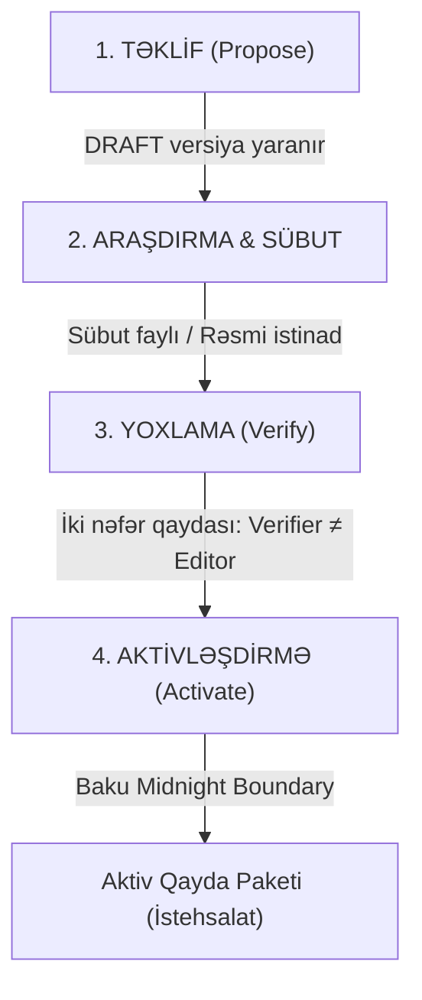

# Compliance Qayda Paketlərinin Yoxlanılması və Aktivləşdirilməsi Təlimatı

> [!WARNING]
> **MÜHASİB VƏ HÜQUQŞÜNASLAR ÜÇÜN ƏSAS TƏLİMAT:**
> Sistemdəki ilkin qayda paketləri `UNVERIFIED` (yoxlanmamış) referans məlumatlarıdır.
> İstehsalat mühitində (`ENV=production`) sistemin vergi, kassa və əməkhaqqı modullarının işləməsi üçün bu qaydaların rəsmi hüquqi aktlar əsasında yoxlanılması və təsdiq edilməsi **MƏCBURİDİR**.

---

## 1. Yoxlama Prosesinin Mərhələləri

Qaydaların yenilənməsi və təsdiqi dörd addımlı zəncirvari prosesdən ibarətdir:

### Addım 1: Dəyişikliyin Təklif Edilməsi (`Propose Change`)
- Qanunvericilikdə dəyişiklik olduqda (məsələn, yeni Vergi Məcəlləsi redaksiyası və ya yeni minimum əməkhaqqı sərəncamı), səlahiyyətli istifadəçi (`compliance.rules.edit`) mövcud paket üçün yeni `DRAFT` versiya təklif edir.
- **API Çağırışı:** `POST /compliance/packs/{pack_id}/versions`
- **Tələb olunan məlumatlar:**
  - `effective_from`: Qanunun qüvvəyə mindiyi tarix (məsələn, `2026-07-01T00:00:00+04:00`).
  - `rules`: Dəyişən qaydaların açarları (`rule_key`), adları və yeni JSON parametrləri.
  - `notes`: Dəyişikliyin hüquqi səbəbi.
- Sistem avtomatik olaraq bu istifadəçini həmin versiyanın redaktoru (`editor_id` və ya `created_by`) kimi qeyd edir.

---

### Addım 2: İlkin Hüquqi Mənbənin və Sübutun Hazırlanması
Yoxlama yalnız rəsmi hüquqi mənbələr əsasında aparıla bilər:
- **Rəsmi Mənbələr (`OFFICIAL`):**
  - Azərbaycan Respublikasının Qanunvericilik Portalı (`e-qanun.az`)
  - "Azərbaycan" qəzeti (Rəsmi Dövlət Qəzeti)
  - Dövlət Vergi Xidmətinin rəsmi bülletenləri (`taxes.gov.az`)
  - Nazirlər Kabinetinin qərarları
- Mühasib və ya hüquqşünas qanunun nömrəsini, maddəsini, dərc tarixini və qüvvəyə minmə şərtlərini çıxarır və PDF/sənəd şəklində sübut bazasına (`evidence_file_id`) əlavə edir.

---

### Addım 3: İki Nəfər Qaydası ilə Yoxlama (`Verify Pack`)
- **TƏHLÜKƏSİZLİK ŞƏRTİ:** Versiyanı yaradan (təklif edən) şəxs həmin versiyanı yoxlaya / təsdiqləyə **BİLMƏZ** (`verifier ≠ editor`). Əks halda sistem `COMPLIANCE_TWO_PERSON_RULE` xətası verərək əməliyyatı dayandırır.
- Yoxlama hüququ olan mühasib və ya hüquqşünas (`compliance.rules.verify`) versiyanı yoxlayır.
- **API Çağırışı:** `POST /compliance/pack-versions/{version_id}/verify`
- **Tələb olunan sahələr:**
  - `verifier_name`: Yoxlayan şəxsin adı və soyadı (məs. "Fərid Əliyev").
  - `verifier_role`: `accountant` (mühasib) və ya `lawyer` (hüquqşünas).
  - `evidence_file_id`: Yüklənmiş rəsmi aktın / sübut faylının unikal ID-si.
  - `evidence_notes`: Ən azı 20 simvoldan ibarət əsaslandırma mətni (məsələn: *"Vergi Məcəlləsinin 173-cü maddəsinə uyğun olaraq 18% dərəcə e-qanun.az portalından yoxlanıldı."*).

Əgər məlumatlar ziddiyyətlidirsə, paket rədd edilə bilər: `POST /compliance/pack-versions/{version_id}/reject`.

---

### Addım 4: Aktivləşdirmə (`Activate Pack`)
- Yoxlanmış paket versiyası səlahiyyətli rəhbər (`compliance.rules.activate`) tərəfindən aktivləşdirilir.
- **API Çağırışı:** `POST /compliance/pack-versions/{version_id}/activate`
- **Sistemin avtomatik icra etdiyi əməliyyatlar:**
  1. **Tarix Normallaşdırılması:** `effective_from` tarixi `Asia/Baku` vaxtı ilə həmin təqvim gününün saat 00:00:00 sərhədinə bərabərləşdirilir.
  2. **Köhnə Versiyanın Əvəzlənməsi:** Əvvəlki aktiv versiyanın statusu avtomatik `SUPERSEDED` edilir, onun `effective_to` sahəsinə yeni versiyanın qüvvəyə minmə tarixi yazılır.
  3. **Keşin Sıfırlanması:** Sistem yaddaşındakı qayda keşi (`_rule_cache`) dərhal təmizlənir.
  4. **Hadisələrin Yayımı:** Outbox vasitəsilə `compliance.pack.activated` və `compliance.rules.invalidated` hadisələri göndərilir.
  5. **Audit Qeydi:** Kimin, nə vaxt və hansı parametrlərlə aktivləşdirdiyi `compliance_events` cədvəlinə əbədi qeyd olunur.

---

## 2. Mübahisəli Qaydaların (`DISPUTED`) Həlli

Toxumlanmış ilkin paketlərdə bəzi qaydalar `DISPUTED` (mübahisəli) olaraq qeyd edilib:
- `payroll.dsmf.employer`: İşəgötürənin DSMF dərəcə strukturu (22%/15%/11% yoxsa 44 AZN sabit).
- `payroll.medical_insurance`: İcbari tibbi sığorta həddi (2,500 AZN yoxsa 8,000 AZN).
- `labor.overtime`: İllik əlavə iş vaxtı hədləri (120 saat və ardıcıl 2 gün üçün 4 saat).

> [!CAUTION]
> **QADAĞA:**
> Sistemdə hər hansı qayda `DISPUTED` statusunda qalarsa, həmin paket **HEÇ BİR HALDA** aktivləşdirilə bilməz.
> Həll qaydası:
> 1. Mühasib və hüquqşünas rəsmi qanun mətnini açır.
> 2. `Propose Change` vasitəsilə qaydanın parametrlərini rəsmi qanuna uyğunlaşdırır (düzgün rəqəmi seçir və digər variantları silir).
> 3. Qaydanın statusunu `UNVERIFIED` edir.
> 4. Sübut əlavə edərək paketi `VERIFIED` edir və yalnız bundan sonra aktivləşdirir.

---

## 3. İstehsalat Qapıları (Feature Gates) və Xəbərdarlıqlar

Sistem hər bir kritik modulun icrasından əvvəl aktiv qayda paketinin statusunu yoxlayır:

| Modul Funksiyası | Tələb Olunan Qayda Paketi | Qeyri-İstehsalat (`dev/staging`) | İstehsalat (`production`) |
| :--- | :--- | :--- | :--- |
| **Satış və Fiskal Çek** | `fiscal_receipt` | İcazə verilir (Warning Banner çıxır) | `COMPLIANCE_RULES_NOT_VERIFIED` xətası ilə bloklanır |
| **Vergi və ƏDV Hesablanması** | `tax_vat` | İcazə verilir (Warning Banner çıxır) | `COMPLIANCE_RULES_NOT_VERIFIED` xətası ilə bloklanır |
| **Əməkhaqqı Yekunlaşdırılması** | `payroll_tax`, `payroll_social` | İcazə verilir (Warning Banner çıxır) | `COMPLIANCE_RULES_NOT_VERIFIED` xətası ilə bloklanır |
| **Razılıq və Məxfilik Tətbiqi** | `personal_data` | İcazə verilir (Warning Banner çıxır) | `COMPLIANCE_RULES_NOT_VERIFIED` xətası ilə bloklanır |

Sistemin ümumi uyğunluq statusu `GET /compliance/status` və `GET /health/details` ünvanlarından izlənilə bilər.

---

## 4. İstehsalat Öncesi Mühasibat Yoxlama Siyahısı (Pre-Go-Live Checklist)

Canlı rejimə keçməzdən əvvəl baş mühasib və hüquqşünas aşağıdakıları tamamlamalıdır:

- [ ] Şirkətin Vergi Rejimi qeyd edilibmi? (`CompanyTaxProfile`: ƏDV ödəyicisi / Sadələşdirilmiş vergi / Digər; VÖEN daxil edilibmi?).
- [ ] Bütün 9 sahə üzrə qayda paketləri `VERIFIED` edilib və iki nəfər qaydası ilə aktivləşdirilibmi?
- [ ] Heç bir qayda `DISPUTED` vəziyyətində qalmayıbmı?
- [ ] Rəsmi e-kassa provayderi seçilib və `FiscalService` sazlanıbmı?
- [ ] 2026-cı il Nazirlər Kabineti istehsalat təqvimi sisteme import edilibmi?
- [ ] Şəxsi məlumat informasiya sistemlərinin dövlət reyestrində qeydiyyat statusu təftiş edilibmi?
- [ ] Şirkətin daxili qaytarma siyasəti qanuni 14 günlük həddən az olmamaq şərtilə tənzimlənibmi?
