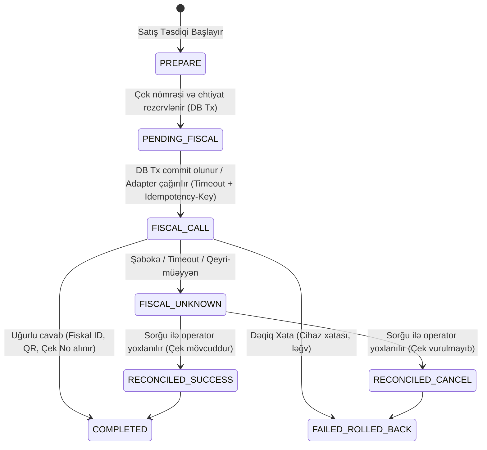

# Fiscal Receipts & E-Kassa Architecture (Azərbaycan Respublikası Tələbləri)

> [!WARNING]
> **HÜQUQİ VƏ TEXNİKİ XƏBƏRDARLIQ:**
> Sistemdə heç bir uydurma (fake) operator adapteri aktiv deyil. `FiscalServicePort` ilkin vəziyyətdə `NOT_CONFIGURED` qaytarır.
> Şirkət Dövlət Vergi Xidməti tərəfindən akkreditasiya olunmuş rəsmi yeni nəsil e-kassa operatoru ilə müqavilə bağlayana və rəsmi API / SDK sənədlərini təqdim edənə qədər real fiskalizasiya aparılmır. Bütün ixraclar `DRAFT` xarakterlidir.

---

## 1. Əsas Prinsiplər və Rejimlər

Vergi Məcəlləsinin 16.1.8-ci maddəsinə əsasən, pərakəndə ticarət və xidmət sahələrində nağd və ya kartla hesablaşmalar Dövlət Vergi Xidmətinin informasiya sisteminə real vaxt rejimində qoşulmuş yeni nəsil e-kassa vasitəsilə həyata keçirilməlidir.

### Rejimlər (`compliance.fiscal.mode`):
1. **`REQUIRED` (İstehsalat Pərakəndə Satışı üçün Default):**
   Fiskal çek alınmadan satış və ya qaytarma əməliyyatı TAMAMLANA BİLMƏZ. Kassa aparatından uğurlu cavab gəlmədikdə ödəniş qəbul edilmir, satış bağlanmır.
2. **`OPTIONAL` (Gelişdirmə / Test / Qeyri-pərakəndə mühit):**
   Fiskal aparat cavab vermədikdə və ya `NOT_CONFIGURED` olduqda satış daxili ERP çeki ilə tamamlanır, lakin qəbzdə `QEYRİ-FİSKAL` xəbərdarlığı qeyd olunur.

---

## 2. Tranzaksiya Dizaynı və Vəziyyət Maşını (State Machine)

İkiqat çek vurulmasının (double fiscalization) və ya pul alınıb çek vurulmaması hallarının qarşısını almaq üçün 3 mərhələli təhlükəsiz tranzaksiya modeli tətbiq edilir:

### Mərhələlər:
1. **PREPARE (`PENDING_FISCAL`):**
   Verilənlər bazası daxili tranzaksiyasında satış üçün unikal kassa nömrəsi rezerv edilir, mallar rezervə atılır və status `PENDING_FISCAL` edilir.
2. **FISCAL CALL (Tranzaksiyadan kənar):**
   Fiskal adapterə şəbəkə çağırışı verilənlər bazası tranzaksiyasından **KƏNARDA** edilir (DB connection pool kilidlənməsin deyə). Çağırış zamanı ciddi şəbəkə timeout-u (məs. 5000 ms) və `Idempotency-Key` (satış ID-si) ötürülür.
3. **NƏTİCƏNİN İŞLƏNMƏSİ:**
   - **Uğur (`OK`):** Fiskal məlumatlar (`fiscal_receipt_id`, `fiscal_number`, `qr_payload`, `device_serial`, `issued_at`, `control_mechanism_registration_no`) sənədə yazılır və satış `COMPLETED` edilir.
   - **Dəqiq Uğursuzluq (`FAILED`):** Fiskal cihaz təsdiqlənmiş imtina qaytardıqda rezerv ləğv edilir, satış bazada `FAILED_ROLLED_BACK` olur, heç bir natamam borc/maliyyə qalığı yaranmır.
   - **Qeyri-müəyyənlik (`UNKNOWN` / `TIMEOUT`):** Əgər kassa cavab vermədisə və ya şəbəkə kəsildisə, sistem **HEÇ VAXT avtomatik təkrar çek vurmur!** Sənəd `FISCAL_UNKNOWN` vəziyyətinə keçirilir. Kassirə xəbərdarlıq çıxır: operator statusu sorğulanmadan və ya əl ilə təftiş edilmədən təkrar çek vurmaq qadağandır.

---

## 3. Xəta Matrisi (Failure Matrix)

| Xəta Ssenarisi | Sistem Vəziyyəti | Təkrar Cəhd Siyasəti | DB Qalıq Vəziyyəti | Kassir Ekranı | Həll Protokolu |
| :--- | :--- | :--- | :--- | :--- | :--- |
| **Normal Uğurlu Satış** | `COMPLETED` | Tələb olunmur | Satış təsdiq edilib, stok silinib, kassa balansı artıb | "Fiskal Çek Çap Edildi" + QR Kod | Normal rejim |
| **Fiskal Cihaz Kağız Qurtardı / Qapaq Açıq** | `FAILED_ROLLED_BACK` | Kağız qoyulduqdan sonra eyni satış yenidən cəhd edilə bilər | Rezerv təmizlənir, heç bir maliyyə sənədi yaranmır | "Kassa xətası: Kağız bitib / Qapaq açıqdır" | Kağızı dəyişin və əməliyyatı təkrar vurun |
| **Operator Şəbəkə Timeout (3-5 saniyə)** | **`FISCAL_UNKNOWN`** | **Avtomatik retry QADAĞANDIR!** İkiqat çek riski var | Sənəd `FISCAL_UNKNOWN` blokunda saxlanılır | "DİQQƏT: Kassa cavab vermədi. Çek çıxdımı?" | `Reconcile` düyməsi ilə operatorun bazasında çekin vurulub-vurulmadığı yoxlanılır |
| **Kart POS Terminalı Təsdiqləndi, lakin Fiskal Xəta Verdi** | **`FISCAL_UNKNOWN`** | Kartdan pul çıxılıb, amma fiskal çek yoxdur | Terminal слип-i saxlanılır, satış dayandırılır | "Bank ödənişi uğurludur, lakin fiskal qeydiyyat uğursuzdur" | Baş kassir tərəfindən operator bazasında yoxlanılır; çek yoxdursa texniki fiskalizasiya vərəqi açılır |
| **Kassada İşıq Söndü / Elektrik Kəsildi** | `FISCAL_UNKNOWN` | Terminal yenidən açıldıqda bərpa rejimi | Açılışda yarımçıq qalmış `PENDING_FISCAL` aşkarlanır | "Yarımçıq qalmış fiskal əməliyyat aşkarlandı" | Sistem Z-report və operator jurnalı ilə uzlaşdırma aparır |
| **Qaytarma Çeki (Return) fiskal xətası** | `FAILED_ROLLED_BACK` | Düzəlişdən sonra təkrar | Qaytarma tamamlanmır, pul kassadan silinmir | "Qaytarma fiskal çeki vurulmadı" | Orijinal çek nömrəsini və operator əlaqəsini yoxlayın |

---

## 4. Fiskal Qəbzin Məcburi Elementləri (Yoxlama Şablonu)

Aktiv `fiscal_receipt` qayda paketinə əsasən, çap olunan və ya elektron göndərilən hər bir qəbzdə aşağıdakı 25 parametr mütləq yoxlanılır:

1. `taxpayer_name` — Vergi ödəyicisinin (şirkətin) tam adı
2. `voen` — Vergi ödəyicisinin eyniləşdirmə nömrəsi (VÖEN)
3. `datetime` — Əməliyyatın tarixi və dəqiq vaxtı
4. `outlet_name` — Ticarət obyektinin adı
5. `tax_office_registration_code` — Obyektin vergi orqanındakı qeydiyyat kodu
6. `address` — Obyektin yerləşdiyi faktiki ünvan
7. `line_item_name` — Hər bir malın/xidmətin adı
8. `unit` — Ölçü vahidi (ədəd, kq, cüt və s.)
9. `quantity` — Miqdar
10. `unit_price` — Vahid qiyməti (ƏDV daxil)
11. `line_total` — Sətir üzrə yekun məbləğ
12. `vat_rate_or_simplified_rate` — Tətbiq edilən ƏDV dərəcəsi (18%, 0%, azad) və ya sadələşdirilmiş vergi
13. `vat_amount` — Sətir üzrə hesablanmış ƏDV məbləği
14. `receipt_number_in_shift` — Növbə daxilində çekin sıra nömrəsi
15. `cash_register_make` — Kassa aparatının markası və modeli
16. `cash_register_serial` — Kassa aparatının zavod seriya nömrəsi
17. `fiscal_mode_mark` — Fiskal rejim nişanı (fiskalizasiya simvolu)
18. `qr_code` — Vergi orqanının portalına yönləndirən dinamik QR kod
19. `amount_paid` — Müştərinin ödədiyi faktiki məbləğ
20. `advance_amount` — Beh (avans) məbləği (varsa)
21. `change_returned` — Qaytarılan qalıq (pul qalığı)
22. `outstanding_amount` — Nisyə / kredit qalığı (borc satışı olduqda)
23. `payment_form` — Ödəniş forması: Nağd, Nağdsız (POS-terminal), Bonus, Hədiyyə kartı
24. `receipt_type` — Çekin növü: Satış (`SALE`), Qaytarma (`RETURN`), Avans (`ADVANCE`)
25. `control_mechanism_registration_no` — Nəzarət-mexanizmi qurğusunun qeydiyyat nömrəsi

---

## 5. Növbə İdarəetməsi (X-Report və Z-Report)

- **Növbənin Açılışı:** Kassir POS-da növbə açdıqda (`Open Shift`), e-kassa aparatında da növbə açılışı qeydə alınır.
- **X-Hesabat (X-Report):** Gün ərzində növbə bağlanmadan cari satışların, nağd/nağdsız məbləğlərin aralıq təftişi üçün çap olunur.
- **Z-Hesabat (Z-Report) və Növbənin Bağlanması:** Növbə bitdikdə Z-report çıxarılır. Kassa aparatındakı dövriyyə məlumatları (fiskal cəmlər) ERP bazasındakı satışlarla müqayisə edilir. Hər hansı fərq aşkarlandıqda sistem avtomatik `ReconciliationAlert` qeydə alır və baş mühasibə bildiriş göndərir.

---

## 6. E-Kassa Operatoru Seçim Meyarları (Mühasibatlıq üçün Yoxlama Siyahısı)

Şirkət rəhbərliyi və mühasibatlıq yeni nəsil e-kassa provayderini seçərkən aşağıdakı tələblərə diqqət yetirməlidir:

- [ ] **Rəsmi Akkreditasiya:** Provayder İqtisadiyyat Nazirliyi yanında Dövlət Vergi Xidmətinin rəsmi reyestrində varmı?
- [ ] **Yerli API / SDK Dəstəyi:** Şəbəkə kəsildikdə oflayn rejimdə müvəqqəti saxlama və bərpa mexanizmi varmı?
- [ ] **İnteqrasiya Metodu:** LAN/Ethernet, Wi-Fi, USB, yoxsa Bulud (Cloud fiscal) API?
- [ ] **Smart Kassa / Hamısı birində (All-in-One):** Bank POS terminalı ilə e-kassanın bir korpusda birləşdirilməsi dəstəklənirmi?
- [ ] **Qaytarma və Avans Əməliyyatları:** Orijinal çek nömrəsinə bağlanaraq qismən qaytarma API vasitəsilə icazə verilirmi?
- [ ] **Fiskal ID və QR Geri Dönüşü:** Hər əməliyyatdan sonra API cavabında `qr_code_url` və `fiscal_id` dərhal təqdim olunurmu?
