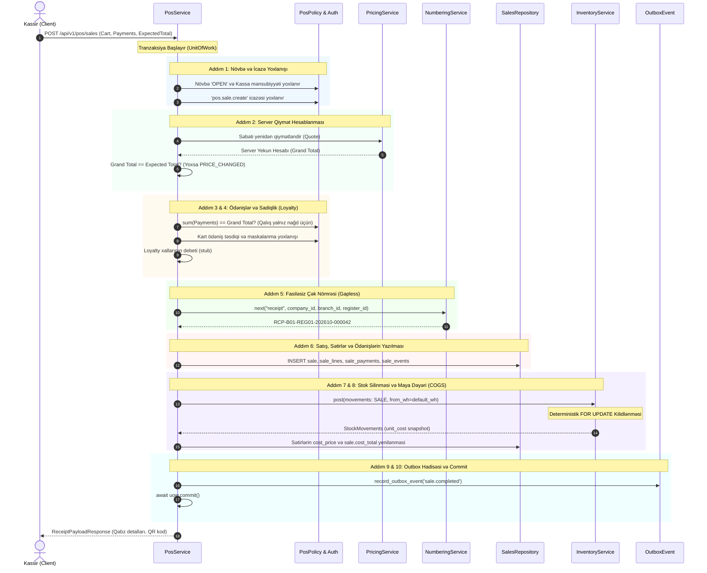

# POS Kassa Satışı və Çıxış Əməliyyatları Memarlığı (POS Checkout Architecture)

## 1. Ümumi Baxış (Overview)
`pos` və `sales` modulları Brend House pərakəndə satış şəbəkəsinin mərkəzi nöqtəsidir. Bu modul kassirlərin növbə idarəçiliyi, nağd və qeyri-nağd vəsaitlərin hərəkəti, səbətlərin dondurulması/bərpası, real vaxt kataloq və stok axtarışı və **10 addımlı atomik çıxış (Checkout)** mexanizmini təmin edir.

### Əsas Prinsiplər
1. **Sıfır Tolerantlıq və Atomiklik:** Ödəniş və ya stok yoxlanışı uğursuz olarsa, satış heç vaxt yekunlaşdırılmır. Bütün 10 addım vahid verilənlər bazası tranzaksiyasında (`UnitOfWork`) icra olunur; hər hansı xəta baş verdikdə bütün dəyişikliklər geri qaytarılır (`Rollback`) və sistemdə heç bir qalıq yazı qalmır (**Zero Residue**).
2. **Server-Authoritative Qiymətləndirmə:** Müştəri tərəfindən göndərilən qiymətlərə heç vaxt etibar edilmir. Qiymətlər çıxış zamanı serverdə təkrar hesablanır; müştərinin gözlədiyi məbləğlə fərq yaranarsa, satış `PRICE_CHANGED` xətası ilə rədd edilir.
3. **Kart Məlumatlarının Təhlükəsizliyi (PCI-DSS):** Açıq kart nömrələri (PAN) və CVV kodları heç vaxt saxlanılmır və loqlaşdırılmır. Yalnız maskalanmış istinad (`**** 1234`) və tranzaksiya təsdiq kodları qəbul edilir.
4. **Append-Only Satış Tarixçəsi:** Tamamlanmış satışlar bazadan heç vaxt silinmir. Ləğvlər eyni növbədə kompensasiya hərəkəti (`SALE_RETURN`) ilə `CANCELLED` statusuna keçirilir.

---

## 2. 10 Addımlı Atomik Çıxış Ardıcıllığı (Sequence Diagram)

---

## 3. Xətalar Matrisi və Rollback Davranışı (Failure Matrix)

| Mərhələ | Xəta Şərti | Xəta Kodu / Tipi | Tranzaksiya Davranışı | Nəticə və Qalıq (Residue) |
|---|---|---|---|---|
| **Addım 1** | Kassa növbəsi bağlıdır və ya kassa uyğun gəlmir | `SHIFT_NOT_OPEN` / `REGISTER_MISMATCH` | Dərhal rədd edilir | Heç bir DB əməliyyatı aparılmır |
| **Addım 1** | Kassirin kassa satışı icazəsi yoxdur | `ForbiddenError` | Dərhal rədd edilir | 403 Forbidden |
| **Addım 2** | Səbət qiyməti müştəri gözləntisindən fərqlidir | `PRICE_CHANGED` | Tranzaksiya ləğv edilir | Yenilənmiş quote cavabda qaytarılır, satış yazılmır |
| **Addım 3** | Ödəniş məbləği çatışmır və ya kartla qalıq tələb olunur | `ValidationError` | Tranzaksiya ləğv edilir | Satış yazılmır, stok toxunulmaz qalır |
| **Addım 3** | Kart inteqrasiyası sazlanmayıb və təsdiq kodu yoxdur | `PAYMENT_PROVIDER_NOT_CONFIGURED` | Tranzaksiya ləğv edilir | Satış yazılmır |
| **Addım 5** | Çək nömrələnməsində konflikt və ya xəta | `NumberingError` | Tranzaksiya ləğv edilir | Çək nömrəsində boşluq (gap) yaranmır |
| **Addım 7** | Anbarda tələb olunan sayda sərbəst qalıq yoxdur | `InsufficientStockError` | **Tam Rollback** | Satış silinir, ödənişlər silinir, stok azalmır |
| **Addım 8** | Maya dəyəri kalkulyasiyası xətası | `CostingError` | **Tam Rollback** | Bütün əməliyyat geri qayıdır |
| **Addım 9** | Outbox hadisəsi yazıla bilmədi | `DatabaseError` | **Tam Rollback** | Hadisə və satış eyni vaxtda geri qayıdır |

---

## 4. Ödənişlər Durum Maşını və Təhlükəsizlik (Payment State Machine)

### Dəstəklənən Ödəniş Vasitələri (`tender_type`):
1. **`cash` (Nağd Pul):**
   - Təqdim edilən məbləğ (`tendered_amount`) ödəniş məbləğindən böyük və ya bərabər olmalıdır.
   - Qalıq (`change_amount = tendered_amount - amount`) avtomatik hesablanır və kassa X/Z hesabatına daxil edilir.
2. **`card` (Bank Kartı):**
   - İnteqrasiya edilmiş rejim (`card_provider_mode == "INTEGRATED"`): Bank POS terminalı vasitəsilə 2 mərhələli tranzaksiya (Pre-auth -> Capture).
   - Xarici müstəqil terminal (`external_terminal_enabled == True`): Kassir bank slipindən unikal `approval_code` (məs: `AUTH123456`) daxil edir.
   - Sazlanmamış rejim (`NOT_CONFIGURED`): Təsdiq kodu təqdim edilmədikdə sistem kart ödənişini qəti qadağan edir.
   - Qalıq (`change_amount`) kart ödənişində həmişə `0.00` olmalıdır.
3. **`split` (Qarışıq Ödəniş):**
   - Eyni çəkdə həm nağd, həm də kart ödənişləri qəbul edilir (`sum(payments) == grand_total`).

---

## 5. Fiskal İnteqrasiya və Çap Arxitekturası (Fiscal Printer & ESC/POS)
1. **ESC/POS Çapı:** Çək satışı tamamlandıqda sistem həm xam ESC/POS baytlarını (Base64), həm də HTML nüsxəsini generasiya edir.
2. **Təkrar Çap (Reprint):**
   - Hər təkrar çap üçün məcburi səbəb daxil edilməlidir.
   - Sayğac (`reprint_count`) artırılır və `SaleEvent(event_type="REPRINTED")` jurnala yazılır.
   - Çapda aydın və silinməz **"NÜSXƏ / DUPLICATE COPY"** su nişanı göstərilir.
3. **Fiskal Kassa İnteqrasiyası (Fiscal Failover):**
   - Fiskal aparat qoşulmadıqda qəbz `fiscal_status = "NOT_CONFIGURED"` kimi qeyd edilir (saxta fiskalizasiya simulyasiyası aparılmır).
   - Fiskal aparat nasaz olduqda, satış bazada uğurla tamamlanır və fiskal hadisə outbox-da növbəyə alınır.

---

## 6. Məhsuldarlıq Hədəfləri və Yüklənmə Testləri (Performance Targets)
- **POS Checkout (10 sətir):** $p95 < 150$ ms
- **POS Quote (10 sətir):** $p95 < 50$ ms
- **POS Lookup (Barkod / SKU):** $p95 < 30$ ms

Yüklənmə testi üçün `backend/tests/load/pos_checkout_locust.py` skriptindən istifadə olunur.

