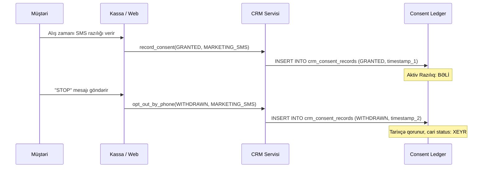

# Müştəri İdarəedilməsi, Məxfilik və Razılıq Jurnalı (CRM & Privacy)

## 1. Giriş və Əsas Prinsiplər
Brend House CRM modulu müştəri bazasının təhlükəsiz idarə olunması, fərdi məlumatların qorunması (AR Qanunvericiliyi və GDPR prinsipləri) və marketinq razılıqlarının şəffaf uçotu üçün nəzərdə tutulmuşdur.

* **Minimal Şəxsi Məlumat (Data Minimization):** Yalnız pərakəndə satış və loyallıq xidmətləri üçün zəruri olan sahələr toplanır.
* **Standart Maskalanma (Masking by Default):** Bütün API cavablarında həssas əlaqə vasitələri (telefon `+99450****567`, e-poçt `e***n@domain`) maskalanmış qaytarılır.
* **Auditli PII Açıqlaması:** Maskalanmamış fərdi məlumatlara baxış (`/crm/customers/{id}/unmask`) üçün `crm.pii.view` hüququ və `audit_reason` əsaslandırması tələb olunur və dəyişməz audit jurnalına yazılır.
* **E.164 Telefon Standartı:** Daxil edilən bütün yerli və beynəlxalq telefon nömrələri avtomatik olaraq standart E.164 formatına (`+994XXXXXXXXX`) gətirilir.

---

## 2. Append-Only Razılıq Jurnalı (Consent Ledger)

Müştərinin razılıq statusu heç vaxt üzərinə yazılmır (never mutated). Hər bir razılıq və ya imtina `crm_consent_records` cədvəlində unikal hadisə kimi saxlanılır:

### Məqsədlər (Purposes)
* `marketing_sms`: Reklam və kampaniya SMS bildirişləri.
* `marketing_email`: E-poçt bülletenləri və xüsusi təkliflər.
* `marketing_whatsapp`: WhatsApp kanalı üzərindən əlaqə.
* `profiling`: Fərdiləşdirilmiş tövsiyələr üçün alış tarixçəsinin analizi.
* `loyalty_terms`: Loyallıq proqramı şərtlərinə razılıq.

### 100% Razılıq Filtri (Consent Filtering)
Kütləvi bildiriş sorğusu (`prepare_send_request`) hazırlandıqda, hədəf auditoriyadan yalnız aktiv `GRANTED` statuslu razılığı olan müştərilər seçilir. Razılığı olmayan və ya imtina etmiş şəxslər avtomatik olaraq 100% kənarlaşdırılır.

---

## 3. Təkrarlanan Profillərin Birləşdirilməsi (Customer Merge)

Eyni şəxsə aid iki profil aşkar edildikdə, geri qaytarıla bilməyən (irreversible) birləşdirmə icra olunur:
1. **İlkin Baxış (`preview_merge`):** Qalib (`winner`) və ləğv ediləcək (`loser`) profillər üzrə köçürüləcək satışların və razılıqların sayı göstərilir.
2. **Satışların Köçürülməsi:** Tarixi `sales` sənədlərində `customer_id` qalib profilə yönləndirilir.
3. **Razılıqların Birləşdirilməsi:** Ləğv edilən profilin bütün razılıq tarixçəsi qalib profilə köçürülür.
4. **Tombstone Alias:** Ləğv edilən profil silinmir; `is_tombstone = True`, `merged_into_id = winner.id` qeyd olunur, telefon və e-poçtu təmizlənir ki, gələcək axtarışlarda unikal ziddiyyət yaratmasın.
5. **Aqreqatların Yenidən Hesablanması:** Qalib profilin ümumi dövriyyəsi (`total_spent`), sifariş sayı (`order_count`) və orta çeki (`average_order_value`) birbaşa satış cədvəlindən yenidən hesablanır.

---

## 4. Məlumat Subyektinin Hüquqları (GDPR / Erasure)

Müştəri məlumatlarının silinməsini tələb etdikdə (`request_data_erasure`):
1. Uçot və vergi auditi məqsədilə tamamlanmış tarixi satışlar maliyyə cədvəllərində qalır.
2. Müştərinin fərdi şəxsiyyətini müəyyən edən məlumatlar tam anonimləşdirilir:
   - Adı `Anonimləşdirilmiş Müştəri ({customer_no})` formatına salınır.
   - Telefon və e-poçt sahələri tamamilə `NULL` edilir.
   - Fərdi qeydlər (`notes`) təmizlənir.
   - Profil statusu `ANONYMIZED` edilir.
3. Məxfilik sorğusu 30 günlük SLA daxilində `PROCESSED` statusuna keçirilir və audit hadisəsi qeydə alınır.

