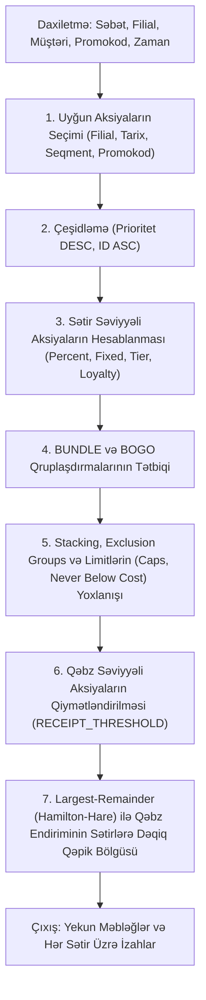

# Server-Authoritative Aksiya və Endirim Mühərriki (Promotion Engine)

## 1. Giriş və Əsas Prinsiplər
Brend House pərakəndə satış sistemində endirim və aksiya hesablamaları üçün yeganə həqiqət mənbəyi (single source of truth) **Server Aksiya Mühərrikidir** (`PromotionEngineImpl`).

* **Determinizm:** Eyni səbət və parametrlər üçün hər zaman 100% eyni nəticə hesablanır.
* **Tarixi Dəyişməzlik:** Kampaniyalarda edilən dəyişikliklər yalnız gələcək qiymətləndirmələrə təsir edir; tamamlanmış tarixi satışlar heç vaxt mutasiyaya uğramır.
* **Server Həqiqəti:** POS ilkin baxış (`/pos/quote`), marketinq simulyatoru (`/marketing/simulate`) və kassa çıxışı (`/pos/sales`) eyni mühərriklə hesablanır.
* **Tam İzah Edilə Bilənlik (Explainability):** Hər bir səbət sətiri üzrə hansı aksiyanın niyə tətbiq edildiyi və ya niyə rədd edildiyi tam audit detalları ilə qaytarılır.

---

## 2. Dəstəklənən Aksiya Növləri

1. **PERCENT_OFF:** Faiz endirimi (məs. bütün yay köynəklərinə 20%).
2. **FIXED_OFF:** Sabit məbləğ endirimi (məs. hər ədədə 10.00 AZN çıxılır).
3. **FIXED_PRICE:** Sabit xüsusi qiymət təyini (məs. normalda 50 AZN olan məhsul 39.99 AZN-ə təklif edilir).
4. **QUANTITY_TIER:** Say pilləsi üzrə proqressiv endirim (məs. 3 ədəd aldıqda 10%, 5 ədəd aldıqda 20% endirim).
5. **LOYALTY_MEMBER:** Loyallıq səviyyəsinə (Bronze, Silver, Gold, Platinum) bağlı xüsusi endirim.
6. **BOGO (Buy X Get Y):** X ədəd al, Y ədəd pulsuz və ya Z% endirimlə qazan (ən ucuz və ya müəyyən edilmiş variant qaydası ilə).
7. **BUNDLE:** Dəst qiyməti (məs. Kostyum + Köynək birlikdə 150 AZN).
8. **RECEIPT_THRESHOLD:** Qəbz həddi endirimi (məs. səbət 100 AZN-i keçdikdə 15 AZN və ya 10% qəbz endirimi).
9. **PROMO_CODE:** Promokod ilə aktivləşən fərdi və ya kampaniya endirimi.

---

## 3. Mühərrikin Alqoritmi və İcra Ardıcıllığı

### Addım 1: Uyğun Aksiyaların Toplanması
* Kampaniyanın statusu (`ACTIVE`, `SCHEDULED`, `APPROVED`).
* Asia/Baku saat qurşağı üzrə başlama və bitmə tarixləri yoxlanılır.
* Hədəf filiallar (`target_branches`) və hədəf müştəri seqmentləri (`target_segments`) filtrlənir.
* Promokod tələb edən aksiyalar yalnız təqdim olunan promokod aktiv və limit daxilində olduqda daxil edilir.

### Addım 2: Çeşidləmə
Aksiyalar `priority` üzrə azalan sırada çeşidlənir. Eyni prioritetli aksiyalar arasında `id ASC` deterministik tie-breaker kimi istifadə edilir.

### Addım 3: Sətir Səviyyəli və Qrup Aksiyaları
* `PERCENT_OFF`, `FIXED_OFF`, `FIXED_PRICE`, `QUANTITY_TIER`, `LOYALTY_MEMBER` qaydaları hər sətir üzrə qiymətləndirilir.
* BOGO və BUNDLE qaydaları üzrə səbətdəki məhsullar cütləşdirilir və qənaət məbləği müvafiq sətirlərə bölünür.

### Addım 4: Stacking, Exclusion Groups və Caps
* **EXCLUSIVE:** Bu rejimli aksiya tətbiq edildikdə digər bütün rəqib aksiyalar həmin məhsuldan çıxarılır.
* **STACKABLE_WITH_GROUPS:** Aksiyalar eyni `exclusion_groups` siyahısını paylaşmırsa, birlikdə tətbiq oluna bilər.
* **ALWAYS_STACK:** Həmişə əlavə olunur (məs. xüsusi kuponlar).
* **Maya Dəyəri Qorunması (`never_below_cost`):** Əgər `allow_below_cost_override = False` olarsa, endirim məbləği heç bir halda satış qiymətini məhsulun maya dəyərindən (`cost_price`) aşağı sala bilməz.
* **Maksimum Limitlər:** `max_discount_per_line` və `max_discount_per_receipt` qoyulmuş hədləri qoruyur.

### Addım 5: Ən Böyük Qalıq (Largest-Remainder / Hamilton-Hare) Qəpik Bölgüsü
Qəbz səviyyəli ümumi endirim sətirlər üzrə mütənasib bölünərkən riyazi kəsrlər yaranır. Sistem integer qəpik səviyyəsində pay bölgüsü aparır:
1. Hər sətrin xalis məbləğinə görə dəqiq qəpik payı hesablanır və tam hissəsi (`int(share)`) ayrılır.
2. Bölünməmiş qalan qəpiklər (`diff_cents`) kəsr hissəsi ən böyük olan sətirlərə 1 qəpik-1 qəpik paylanır.
3. Nəticədə sətirlərə paylanan endirimlərin cəmi **DƏQİQ 100.00%** ümumi qəbz endiriminə bərabər olur (qəpik itkisi və ya uyğunsuzluq 0-dır).

---

## 4. Keşləmə və Performans
* Kompilyasiya olunmuş aktiv qaydalar yaddaşda saxlanılır (`_compiled_cache`).
* Kampaniya və ya aksiya yeniləndikdə, Outbox hadisələri və ya `PromotionEngineImpl.invalidate_cache()` vasitəsilə keş avtomatik sıfırlanır.
* 20 sətirli və 200 aktiv aksiyalı səbət qiymətləndirməsi $p95 < 40\text{ ms}$ müddətində tamamlanır.

