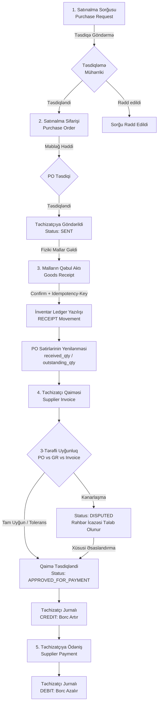

# Satınalma və Təchizat İdarəetməsi (Purchasing & Suppliers Architecture)

`brend_house` pərakəndə mağazalar şəbəkəsi üçün arxitektur cəhətdən möhkəm, tranzaksional bütövlüyü təmin edən və beynəlxalq ERP standartlarına uyğun Satınalma (`purchasing`), Təchizatçılar (`suppliers`) və Təsdiqləmə Mühərriki (`approvals`) modullarının texniki sənədləşməsi.

---

## 1. Əsas Prinsiplər və Arxitektura

1. **Vahid Həqiqət Mənbəyi (Single Source of Truth):**
   - **İnventar üçün:** Mallar anbara YALNIZ Malların Qəbul Aktı (`Goods Receipt`) təsdiqləndikdə daxil olur və eyni DB tranzaksiyasında `InventoryService.post` vasitəsilə `stock_movements` (Ledger) və `stock_balances` cədvəllərinə yazılır.
   - **Təchizatçı borcları üçün:** Təchizatçı balansı redaktə edilən sahə kimi saxlanılmır. Bütün borclar dəyişməz, yalnız əlavə olunan `supplier_ledger_entries` (Append-Only Ledger) jurnalından törədilir (`Sum(CREDIT) - Sum(DEBIT)`).
2. **Dəqiq Maliyyə Hesablamaları (Decimal Precision):**
   - Bütün pul və kəmiyyət hesablamaları `Decimal` tipləri və `ROUND_HALF_UP` (4 onluq xana) strategiyası ilə həyata keçirilir.
3. **Vəzifələrin Bölünməsi (Segregation of Duties - SoD):**
   - Sənədi (PR, PO, Ödəniş) formalaşdıran istifadəçi öz sənədini təsdiq edə bilməz (`requester_id != approver_id`).
   - Satınalma sifarişini açan menecer qaiməni təsdiqləyib ödənişi icra edə bilməz.
4. **Çoxpilləli Təsdiqləmə Mühərriki (`approvals`):**
   - Digər biznes modullarından (`purchasing`, `finance`, `hr`) tam ayrılmış müstəqil mühərrik. Məbləğ hədləri, filiallar, rollar və icazələr üzrə pilləli təsdiq axını təmin edir.

---

## 2. Satınalma Tam Həyat Dövrü (End-to-End Workflow)

---

## 3. Statuslar və Həyat Dövrü Cədvəlləri

### 3.1. Satınalma Sorğuları (Purchase Requests)
| Status | Açıqlama | Keçid Şərtləri |
| :--- | :--- | :--- |
| `DRAFT` | Tələbnamə qaralama şəklindədir, redaktə edilə bilər. | İlkin yaradılış. |
| `SUBMITTED` | Təsdiqləmə mühərrikinə göndərilib, qərar gözləyir. | İstifadəçi təsdiqə göndərdikdə. |
| `APPROVED` | Səlahiyyətli şəxs tərəfindən təsdiqlənib (və ya qayda olmadıqda avtomatik). | Qaydalar tamamlandıqda. |
| `REJECTED` | İmtina edilib (mütləq səbəb qeyd olunur). | Təsdiqçi rədd etdikdə. |
| `RETURNED` | Düzəliş üçün geri qaytarılıb. | Təsdiqçi geri qaytardıqda. |
| `CONVERTED` | Satınalma sifarişinə (PO) çevrilib. | PO yaradıldıqda. |
| `CANCELLED` | Ləğv edilib. | Yaradan və ya rəhbər tərəfindən. |

### 3.2. Satınalma Sifarişləri (Purchase Orders)
| Status | Açıqlama | Keçid Şərtləri |
| :--- | :--- | :--- |
| `DRAFT` | Sifariş qaralama halındadır. | Sifariş yaradıldıqda. |
| `PENDING_APPROVAL` | Dəyəri təsdiq limitini aşır və ya reviziya olunub. | Reviziyada məbləğ artdıqda. |
| `APPROVED` | Rəhbərlik tərəfindən təsdiqlənib. | Səlahiyyətli şəxs təsdiqlədikdə. |
| `SENT` | Təchizatçıya rəsmi göndərilib. | PDF çıxarışı / göndəriş qeydi. |
| `PARTIALLY_RECEIVED`| Malların bir hissəsi anbara daxil olub. | Qəbul aktı təsdiqləndikdə. |
| `RECEIVED` | Bütün sifariş tam həcmdə qəbul edilib. | `outstanding_qty == 0`. |
| `CLOSED` | Qalıq miqdar ləğv edilərək bağlanıb (Close Short). | Təchizatçı qalanı göndərə bilmədikdə. |
| `CANCELLED` | Sifariş ləğv edilib. | Qəbul aktı yoxdursa. |

### 3.3. Malların Qəbul Aktları (Goods Receipts)
| Status | Açıqlama | Keçid Şərtləri |
| :--- | :--- | :--- |
| `DRAFT` | Anbarda sayım və yoxlama aparılır. | Qəbul sənədi açıldıqda. |
| `CONFIRMED` | Mallar təsdiqlənib, inventar hərəkətləri yazılıb. | `confirm_receipt` çağırıldıqda. |
| `REVERSED` | Qəbul aktı ləğv edilib (kompensasiya hərəkətləri ilə). | Səhvlər aşkarlandıqda. |

---

## 4. 3-Tərəfli Uyğunlaşma Mühərriki (Three-Way Match Engine)

Təchizatçı qaiməsi (`SupplierInvoice`) daxil edildikdə avtomatik olaraq sifariş (`PO`) və faktiki qəbul (`GR`) sətirləri ilə tutuşdurulur:

1. **Miqdar Yoxlanışı (Quantity Check):**
   $$\text{Invoice Qty} \le \text{Received Qty}$$
   Qaimə miqdarı faktiki qəbul edilmiş miqdardan çox olduqda dərhal `DISCREPANCY` (kənarlaşma) statusu alır.
2. **Qiymət Yoxlanışı (Price Variance):**
   - Əgər $\text{Invoice Price} \le \text{PO Price}$, qiymət uyğun hesab olunur.
   - Qiymət artımı olduqda:
     $$\Delta P = \text{Invoice Price} - \text{PO Price}$$
     $$\% \Delta P = \frac{\Delta P}{\text{PO Price}} \times 100$$
     - Əgər $\% \Delta P \le 2.0\%$ və $\Delta P \le 5.00\text{ AZN}$ olarsa $\rightarrow$ `TOLERATED` (icazə verilən kənarlaşma).
     - Əks halda $\rightarrow$ `DISCREPANCY`.
3. **Kənarlaşmanın Təsdiqi:**
   - Kənarlaşması olan qaimələr (`DISPUTED`) adi qaydada təsdiqlənə bilməz.
   - Yalnız `purchasing.invoice.override_match` icazəsi olan səlahiyyətli menecer mütləq səbəb (`override_reason`) göstərərək qaiməni təsdiqləyə bilər.

---

## 5. Təchizatçı Hesablaşma Jurnalı (Append-Only Ledger)

Təchizatçı borcları cədvəli heç bir birbaşa `UPDATE` və ya `DELETE` əməliyyatına icazə vermir. Bütün dəyişikliklər `supplier_ledger_entries` cədvəlində qeyd olunur:

| Əməliyyat Növü | İstiqamət | Borca Təsiri | Mənbə Sənəd |
| :--- | :--- | :--- | :--- |
| `INVOICE` | `CREDIT` | Artırır (+) | Təsdiqlənmiş Təchizatçı Qaiməsi |
| `PAYMENT` | `DEBIT` | Azaldır (-) | Təchizatçı Ödənişi |
| `CREDIT_NOTE` | `DEBIT` | Azaldır (-) | Mal Qaytarma Aktı (Purchase Return) |
| `ADJUSTMENT` | `CREDIT` / `DEBIT` | Düzəliş | Mühasibat aktı |
| `REVERSAL` | `CREDIT` / `DEBIT` | Kompensasiya | Ləğv olunmuş ödəniş/qaimə |

### Cari Qalıq Hesablanması:
$$\text{Current Balance} = \sum \text{Amount}_{\text{CREDIT}} - \sum \text{Amount}_{\text{DEBIT}}$$

### Borcların Yaşlanması (Payables Aging):
Ödənilməmiş borc sənədlərinin icra müddətinə (`due_date`) görə qruplaşdırılması:
- **Cari (Current):** $\text{due\_date} \ge \text{today}$ (hələ vaxtı çatmayıb).
- **1 – 30 gün:** Gecikmə müddəti 1-30 gün.
- **31 – 60 gün:** Gecikmə müddəti 31-60 gün.
- **61 – 90 gün:** Gecikmə müddəti 61-90 gün.
- **90+ gün:** 90 gündən çox gecikmiş kritik borclar.

---

## 6. API Marşrutları İcmalı

| Metod | Endpoint | Təsvir | Tələb Olunan İcazə |
| :--- | :--- | :--- | :--- |
| `POST` | `/api/v1/suppliers` | Yeni təchizatçı qeydiyyatı | `suppliers.manage` |
| `GET` | `/api/v1/suppliers` | Təchizatçıların axtarışı və filtrlənməsi | `suppliers.manage` |
| `GET` | `/api/v1/suppliers/{id}` | Tək təchizatçı (bank rekvizitləri maskalanır) | `suppliers.manage` |
| `POST` | `/api/v1/suppliers/check-duplicates` | VÖEN və ada görə dublikat aşkarlanması | `suppliers.manage` |
| `POST` | `/api/v1/suppliers/merge` | İki təchizatçının birləşdirilməsi | `suppliers.manage` |
| `GET` | `/api/v1/suppliers/{id}/statement` | Təchizatçı borc çıxarışı və Aging hesabatı | `suppliers.manage` |
| `GET` | `/api/v1/suppliers/{id}/metrics` | Təchizatçı keyfiyyət və performans göstəriciləri | `suppliers.manage` |
| `POST` | `/api/v1/approvals/rules` | Yeni təsdiqləmə qaydası təyini | `approvals.rule.manage` |
| `POST` | `/api/v1/approvals/{id}/decide` | Təsdiq, imtina və ya geri qaytarma qərarı | `approvals.decide` |
| `POST` | `/api/v1/purchasing/requests` | Yeni satınalma sorğusu (PR) | `purchasing.request.create` |
| `POST` | `/api/v1/purchasing/requests/{id}/submit` | Sorğunu təsdiq zəncirinə göndərmə | `purchasing.request.create` |
| `GET` | `/api/v1/purchasing/reorder-suggestions` | Avtomatik ehtiyat təchizat təklifləri | `purchasing.request.create` |
| `POST` | `/api/v1/purchasing/orders` | Satınalma sifarişi (PO) açılması | `purchasing.order.create` |
| `POST` | `/api/v1/purchasing/orders/{id}/approve` | Sifarişin təsdiqi | `purchasing.order.approve` |
| `POST` | `/api/v1/purchasing/orders/{id}/send` | Sifarişin təchizatçıya göndərilməsi | `purchasing.order.send` |
| `POST` | `/api/v1/purchasing/orders/{id}/close-short` | Çatışmayan qalığın bağlanması | `purchasing.order.cancel` |
| `POST` | `/api/v1/purchasing/receipts` | Malların fiziki qəbul aktı (Draft) | `purchasing.receipt.confirm` |
| `POST` | `/api/v1/purchasing/receipts/{id}/confirm` | Qəbulun təsdiqi və inventara atomik daxilolma | `purchasing.receipt.confirm` |
| `POST` | `/api/v1/purchasing/invoices` | Təchizatçı qaiməsinin daxil edilməsi | `purchasing.invoice.approve` |
| `POST` | `/api/v1/purchasing/invoices/{id}/approve` | Qaimənin təsdiqi və borcun jurnala yazılışı | `purchasing.invoice.approve` |
| `POST` | `/api/v1/purchasing/returns` | Təchizatçıya mal qaytarma və kredit notası | `purchasing.receipt.confirm` |
| `POST` | `/api/v1/purchasing/payments` | Təchizatçıya ödəniş və qaimələrə bölüşdürmə | `purchasing.payment.create` |
| `GET` | `/api/v1/purchasing/payables/aging` | Bütün şirkət üzrə borcların yaşlanması | `purchasing.payment.create` |

