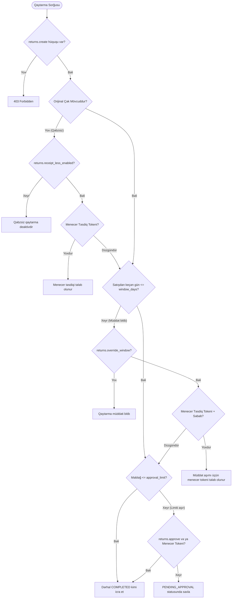
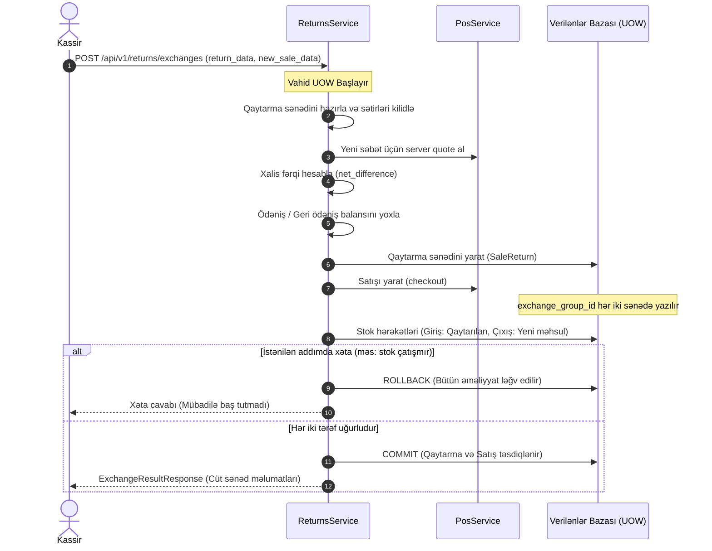

# Qaytarmalar, Mübadilələr və Geri Ödənişlər Memarlığı (Returns, Exchanges & Refunds Architecture)

## 1. Ümumi Baxış və Əsas Prinsiplər (Overview & Core Principles)

`returns` modulu Brend House pərakəndə satış sisteminin maliyyə, stok, kassa və müştəri loyallığı nöqteyi-nəzərindən ən həssas və dəqiq icra tələb edən komponentidir. Modul satılmış məhsulların tam və ya hissə-hissə qaytarılmasını, yerində mübadiləsini (Exchange), qəbzli və qəbzsiz qaytarmaları, mağaza kreditinin (Store Credit) dövriyyəsini və kassa növbəsi ilə inteqrasiya olunmuş nağd/qeyri-nağd geri ödənişləri tənzimləyir.

### Əsas Təhlükəsizlik və İntegrasiya Prinsipləri:
1. **Kəmiyyət Təhlükəsizliyi (Quantity Safety & Invariant):**
   Bir satış sətri üzrə qaytarıla biləcək maksimal miqdar qəti düsturla məhdudlaşdırılır:
   $$\text{returnable\_qty} = \text{sold\_qty} - \sum(\text{already\_returned\_qty}) - \sum(\text{reserved\_qty})$$
   Paralel və ya təkrar sorğularda bu hədd heç bir şəraitdə aşıla bilməz.
2. **Dəyişməzlik və Append-Only Tarixçə:**
   Yekunlaşdırılmış satışlar, təsdiqlənmiş qaytarma sənədləri və maliyyə əməliyyatları bazadan qətiyyən silinmir və redaktə edilmir. Bütün düzəlişlər, ləğvlər və geri ödənişlər əlaqələndirilmiş əlavə sənədlər (additive records) vasitəsilə icra olunur.
3. **Vahid Tranzaksiya Atomikliyi (Single-Transaction Atomicity):**
   Qaytarma sənədi, anbar stokunun artırılması (`SALE_RETURN`), kassa növbəsinin nağd pul çıxarışı (`CASH_OUT`), mağaza krediti jurnalı (`store_credit_ledger`), müştəri loyallıq xallarının çıxılması və outbox hadisələri **tək bir verilənlər bazası tranzaksiyasında (`UnitOfWork`)** tamamlanır. İstənilən addımda xəta baş verərsə, bütün proses geri qaytarılır (**Zero Residue**).
4. **Server-Authoritative Qiymət Snapshotları:**
   Qaytarılan hər bir vahidin qiyməti, endirimi, vergi dərəcəsi və maya dəyəri (`cost_price`) mütləq şəkildə **orijinal satış sətrinin snapshotundan** götürülür. Qaytarma anında kataloqda olan cari qiymət nəzərə alınmır.
5. **Mübadilə Cütlüyü Qorunması (`exchange_group_id` & `EXCHANGE_PAIR_LOCKED`):**
   Mübadilə zamanı qaytarma sənədi və yeni satış sənədi eyni anda yaranır və `exchange_group_id` ilə bağlanır. Cütün hər hansı bir tərəfi təkbaşına ləğv edilə bilməz.

---

## 2. Qaytarma Vaxt Həddi və Menecer Səlahiyyətləri (Return Window & Approvals)

Qaytarma əməliyyatlarında fırıldaqçılığın və səlahiyyət aşımının qarşısını almaq üçün çoxpilləli yoxlama mexanizmi tətbiq olunur:



### Əsas Siyasət Qaydaları:
- **Qaytarma Pəncərəsi (`window_days`):** Standart olaraq 14 təqvim günü (`returns.window_days`). Müddət bitdikdən sonra yalnız `returns.override_window` icazəsi, etibarlı `manager_approval_token` və məcburi `reason_code` təqdim edildikdə əməliyyat icazəli sayılır.
- **Təsdiq Limiti (`approval_limit_amount`):** Qaytarma məbləği təyin olunmuş limiti (məsələn, 200.00 AZN) keçdikdə kassa əməliyyatçısının birbaşa yekunlaşdırma hüququ məhdudlaşdırılır. Menecer tokeni olmadıqda sənəd `PENDING_APPROVAL` statusuna keçirilir.
- **Qəbzsiz Qaytarmalar (Receipt-less):**
  - Müştərinin identifikasiyası məcburidir (`customer_id`).
  - Məhsulun qiyməti sistemdəki son ən aşağı qiymət siyasətinə uyğun hesablanır.
  - Həmişə menecer təsdiq tokeni tələb edir və fırıldaqçılıq monitorinqi üçün xüsusi audit qeydi yaradılır.

---

## 3. Mütənasib Endirim Bölüşdürülməsi və Qəpik Dəqiqliyi (Proportional Apportionment)

Satış zamanı tətbiq edilmiş qəbz səviyyəli endirimlər (məsələn, promokodlar və ya ümumi faiz endirimləri) qaytarma zamanı sətirlər üzrə mütənasib şəkildə geri hesablanır.

### Largest-Remainder (Hamilton-Hare) Qəpik İtməzliyi Alqoritmi:
Məbləğlər sent / qəpik səviyyəsində yuvarlaqlaşdırılarkən yaranan qalıq qəpiyin itməməsi üçün alqoritm aşağıdakı addımlarla işləyir:
1. Hər bir sətir üzrə nəzəri endirim payı hesablanır:
   $$\text{exact\_share}_i = \frac{\text{line\_total}_i}{\text{sale\_subtotal}} \times \text{receipt\_discount}$$
2. Ədədin tam qəpik hissəsi götürülür: $\text{floor\_share}_i = \lfloor \text{exact\_share}_i \times 100 \rfloor / 100$.
3. Cəmlənmiş tam qəpiklərlə ümumi endirim arasındakı fərq tapılır:
   $$\text{penny\_remainder} = \text{receipt\_discount} - \sum \text{floor\_share}_i$$
4. Qalıq qəpiklər kəsr hissəsi ($\text{exact\_share}_i - \text{floor\_share}_i$) ən böyük olan sətirlərə tək-tək paylanır.

Bu mexanizm sayəsində qəbz üzrə qaytarılan sətirlərin endirim cəmi ilə ilkin satış endirimi arasında **heç vaxt 1 qəpik belə sapma yaranmır**.

---

## 4. Aksiyaların Yenidən Qiymətləndirilməsi Matrisi (Promotion Invalidation Matrix)

Şərtli aksiyalar (BOGO, Bundle / Dəst, Həcm endirimləri) tətbiq olunmuş çəklərdən qismən qaytarılma edildikdə ilkin aksiya şərti pozula bilər.

| Aksiya Tipi | Qaytarma Ssenarisi | Sistem Reaksiyası və Təkrar Hesablama Siyasəti |
|---|---|---|
| **BOGO (1 Alana 1 Hədiyyə / -50%)** | Əsas ödənişli məhsul qaytarılır, pulsuz məhsul saxlanılır | Pulsuz verilmiş məhsulun aksiya güzəşti ləğv edilir; geri ödəniləcək məbləğdən saxlanılan məhsulun faktiki endirim dəyəri çıxılır. |
| **BOGO (1 Alana 1 Hədiyyə / -50%)** | Hədiyyə verilmiş məhsul qaytarılır | Orijinal çəkdə mütənasib bölüşdürülmüş real ödəniş məbləği (proportional paid amount) geri qaytarılır. |
| **Bundle (Dəst Məhsul Endirimi)** | Dəstdən yalnız bir məhsul qaytarılır | Dəst bütövlüyü pozulduğu üçün qalan məhsullar standart pərakəndə qiymətinə keçirilir; fərq geri ödəniş məbləğindən tutulur. |
| **Həcm Endirimi (3 ədəd alana 10% endirim)** | 1 ədəd qaytarılır və say 2-yə düşür | Minimum say şərti ödəmədiyi üçün saxlanılan 2 ədəd üçün verilmiş 10% endirim geri tutulur və müştəriyə xalis qalıq qaytarılır. |

Müştəriyə sürpriz olmaması üçün istənilən qaytarma icra edilməzdən əvvəl **`POST /api/v1/returns/quote`** endpointi vasitəsilə dəqiq simulyasiya və kəsr bölgüsü öncədən nümayiş etdirilir.

---

## 5. Paralellik və Dedlokun Qarşısının Alınması (Concurrency & Deadlock Prevention)

Eyni satış çeki üzrə fərqli kassalardan eyni vaxtda qaytarma sorğuları daxil olduqda race condition və artıq qaytarılma (over-return) riskini aradan qaldırmaq üçün xüsusi memarlıq tətbiq edilmişdir:

### Sətir Səviyyəli Kilidlənmə Mexanizmi:
1. Hər bir satış sətri üçün unikal `sale_line_return_states` cədvəlində sayğac sətiri mövcuddur.
2. Qaytarma əməliyyatı başlayan kimi tələb olunan bütün `sale_line_id`-lər artan sıra ilə nizamlanır:
   $$\text{sorted\_ids} = \text{sorted}(\text{requested\_sale\_line\_ids})$$
3. Bu deterministik ardıcıllıqla PostgreSQL-də **`SELECT ... FOR UPDATE`** icra olunur. Bu yanaşma əks istiqamətli resurs gözləmələrini və **verilənlər bazası dedloklarını 100% aradan qaldırır**.
4. Sayğac yoxlanışı və artımı:
   $$\text{returned\_qty} + \text{reserved\_qty} + \text{new\_qty} \le \text{sold\_qty}$$
   Şərt ödənmədikdə tranzaksiya `QuantitySafetyError` ilə dayandırılır.

---

## 6. Atomik Geri Ödəniş Orkestrasiyası (Atomic Refund Orchestration)

Qaytarma təsdiqləndikdə (`COMPLETED`), sistem aşağıdakı addımları **vahid tranzaksiyada** icra edir:

```mermaid
sequenceDiagram
    autonumber
    actor C as Kassir
    participant RET as ReturnsService
    participant POL as ReturnsPolicy
    participant SAL as SalesRepository
    participant INV as InventoryService
    participant SFT as CashMovementService
    participant SCR as StoreCreditLedger
    participant OUT as OutboxEvent

    C->>RET: POST /api/v1/returns (ReturnPayload, Refunds)
    Note over RET: Tranzaksiya Başlayır (UnitOfWork)
    
    RET->>POL: Səlahiyyət, Return Window və Limitləri yoxla
    RET->>SAL: lock_sale_lines_for_update(sorted_ids)
    Note over SAL: Sətir sayğacları bloklanır və yoxlanır
    
    RET->>RET: next_return_number("return") -> RET-202610-000001
    RET->>SAL: INSERT sale_returns, sale_return_lines, refunds
    
    rect rgb(240, 248, 255)
    Note over RET,INV: 1. Stok Hərəkəti (SALE_RETURN)
    RET->>INV: post(type=SALE_RETURN, lines, snapshot_cost)
    Note over INV: Resalable -> Əsas anbar; Damaged -> Qüsur anbarı
    end

    rect rgb(255, 250, 240)
    Note over RET,SFT: 2. Kassa Növbəsi və Nağd Çıxarış
    opt Nağd Geri Ödəniş Varsa
        RET->>SFT: Növbə nağd qalığını yoxla (expected_cash >= cash_refund)
        RET->>SFT: record_movement(type=CASH_OUT, reason="SALE_REFUND")
    end
    end

    rect rgb(245, 255, 250)
    Note over RET,SCR: 3. Mağaza Krediti (Store Credit)
    opt Store Credit Seçilibsə
        RET->>SCR: record_ledger(type=ISSUE, customer_id, amount)
    end
    end

    rect rgb(240, 255, 240)
    Note over RET,OUT: 4. Outbox Hadisələri və Commit
    RET->>OUT: emit('return.completed', return_id, totals)
    RET->>RET: await uow.commit()
    end

    RET-->>C: ReturnReceiptPayloadResponse (Qaytarma qəbzi)
```

### Anbar və Kassa Qaydaları:
- **Məhsulun Vəziyyəti (`condition`):**
  - `RESALABLE`: Məhsul kassa filialının standart satış anbarına (`default_warehouse_id`) qaytarılır və dərhal satış üçün əlçatan olur.
  - `DAMAGED` / `RESTRICTED`: Məhsul zədəli və ya karantin anbarına yönləndirilir, satış qalıqlarına daxil edilmir.
- **Nağd Pul Təhlükəsizliyi:** Kassa siyirməsində faktiki gözlənilən nağd vəsaitdən artıq nağd geri ödəniş edilə bilməz (`DRAWER_INSUFFICIENT_CASH`).

---

## 7. Mübadilə Arxitekturası (Exchange Architecture)

Mübadilə əməliyyatı köhnə məhsulun qaytarılması ilə yeni məhsulun satışını eyni anda reallaşdıran atomik biznes ssenarisidir.

### Xalis Qiymət Fərqinin Tənzimlənməsi (Net Settlement):
$$\text{net\_difference} = \text{new\_sale\_grand\_total} - \text{return\_refund\_total}$$

1. **Müştəri Əlavə Ödəniş Edir ($\text{net\_difference} > 0$):**
   Müştəri yaranan müsbət fərqi nağd və ya kartla ödəyir. Ödənişlər massivinin cəmi bu fərqə tam bərabər olmalıdır.
2. **Müştəriyə Pul Geri Qaytarılır ($\text{net\_difference} < 0$):**
   Yaranan mənfi fərq qədər məbləğ müştəriyə nağd, kart və ya mağaza krediti kimi geri ödənilir.
3. **Bərabərdəyərli Mübadilə ($\text{net\_difference} == 0$):**
   Heç bir pul hərəkəti tələb olunmur; əməliyyat sıfır ödənişlə balanslaşdırılır.

### Mübadilə Əməliyyatının İcrası:


### Mübadilə Cütlüyünün Bloklanması (`EXCHANGE_PAIR_LOCKED`):
Əlaqələndirilmiş qaytarma və satış sənədlərindən biri ayrılıqda sistemdən ləğv edilə və ya silinə bilməz. Belə cəhd edildikdə sistem `BusinessRuleViolationError("EXCHANGE_PAIR_LOCKED")` xətası qaytarır.

---

## 8. Xətalar Matrisi (Failure Matrix)

| Xəta Kodu | Səbəb | HTTP Status | Tranzaksiya Nəticəsi |
|---|---|---|---|
| `RETURN_WINDOW_EXPIRED` | Satışdan keçən gün `window_days` həddini aşıb və təsdiq tokeni yoxdur | 422 Unprocessable | Əməliyyat icra olunmur |
| `APPROVAL_REQUIRED` | Qaytarma məbləği təsdiq limitini aşır | 403 Forbidden | Əməliyyat `PENDING` qalır və ya rədd edilir |
| `QUANTITY_EXCEEDED` | Qaytarılmaq istənən say sərbəst qaytarıla bilən saydan çoxdur | 422 Unprocessable | Dərhal Rollback |
| `DRAWER_INSUFFICIENT_CASH` | Kassada tələb olunan qədər nağd pul yoxdur | 422 Unprocessable | Satış və qaytarma yazılmır |
| `STORE_CREDIT_DISABLED` | Mağaza krediti sistemi parametrlərdə deaktivdir | 422 Unprocessable | Rollback |
| `EXCHANGE_SUM_MISMATCH` | Xalis mübadilə fərqi ilə təqdim edilən ödəniş/refund uyğun gəlmir | 422 Unprocessable | Rollback |
| `EXCHANGE_PAIR_LOCKED` | Mübadilə cütünün tərəflərindən birini təkbaşına ləğv etmə cəhdi | 400 Bad Request | Əməliyyat rədd edilir |
| `INSUFFICIENT_STOCK` | Mübadilədə verilən yeni məhsulun anbar qalığı çatmır | 422 Unprocessable | Həm satış, həm qaytarma tam Rollback olunur |

